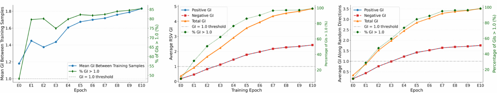
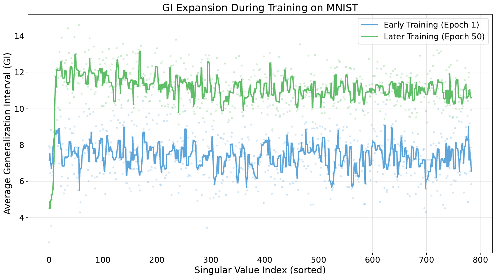

# Neural Expansion

Explore how neural networks develop stable predictions along different directions in input space. This repository provides models, training code, Generalization Interval (GI) measurements, Jacobian analysis, and experiments for studying generalization, class imbalance, random labels, adversarial examples, and distribution shift.

The accompanying research is **Neural Expansion: A Unified Mechanism for How Deep Neural Networks Generalize**, by Chashi Mahiul Islam, Samuel Jacob Chacko, Mao Nishino, Canlin Zhang, and Xiuwen Liu (NeurIPS 2026).



## What is a Generalization Interval?

A Generalization Interval measures how far an input can move along a chosen direction before the model changes its predicted class. Different directions can have very different intervals around the same image.

For a path from a training image to a test image, we evaluate:

```text
x(epsilon) = x_train + epsilon * (x_test - x_train)
```

At `epsilon = 0` we are at the training image; at `epsilon = 1` we reach the test image. If the sampled GI exceeds 1, prediction stayed stable along the sampled path to that test image. **Ray coverage** summarizes how often training anchors cover a target image. Jacobian right singular vectors (RSVs) let us compare sensitive directions with directions that have little effect on the learned representation.

## Get started

Download or clone this repository, open a terminal in its root, and install with **Python 3.11** (supported range: 3.10–3.12):

```bash
python3.11 -m venv .venv
source .venv/bin/activate
python -m pip install --upgrade pip setuptools wheel
python -m pip install -r requirements.txt
python -m pip install --no-deps --no-build-isolation -e .
export PYTHONPATH="$PWD${PYTHONPATH:+:$PYTHONPATH}"
```

PyTorch/torchvision provide models and datasets; timm provides ImageNet transformers. NumPy, SciPy, scikit-learn, pandas and h5py support analysis and storage; Matplotlib and seaborn produce plots. PyYAML, click and tqdm support configuration and execution. Versions are listed in [requirements.txt](requirements.txt).

For CUDA, install the matching **torch 2.2.0 / torchvision 0.17.0** wheels using the [PyTorch installation instructions](https://pytorch.org/get-started/previous-versions/). Analysis runners select CUDA when available and otherwise use CPU; pass `--device cpu` to select it explicitly. Small examples work on CPU; full coverage and dense Jacobian studies benefit from a GPU.

### Try coverage with a pretrained model

This command downloads CIFAR-10 and pretrained ResNet20 weights on first use, selects one test image per class, and evaluates 20 training anchors per image. It needs no local checkpoint file:

```bash
python experiments/04_test_coverage/run.py \
  --pretrained resnet20 --data-path data/CIFAR10 \
  --k 1 --pool-size 20 --batch-size 20 \
  --output results/first_coverage
```

Open `results/first_coverage/coverage.csv` for per-image measurements and `coverage.png` for a summary plot. `run.json` records the settings. This small run introduces the workflow; the experiment READMEs give larger configurations and the settings used for the research studies.

### Explore the implementation

| Start here | What you can explore |
| --- | --- |
| [GI computation](src/analysis/gi_calculation.py) | Positive/negative directional searches and batched training-to-target measurements |
| [Models](src/models) | MLPs, CNNs and lightweight vision transformers, including feature extraction |
| [Training](src/training/mnist_train.py) | Configurable datasets, optimizers, validation, saved weights and learning curves |
| [Dataset recipes](src/datasets.py) | Seeded random labels and long-tail class sampling |
| [Analysis runners](src/reproduce.py) | Coverage, directional profiles, linearity, trajectories, OOD inputs and gradient projections |
| [Model/data loaders](src/runtime.py) | Custom weights, pretrained models, preprocessing and ImageNette label mapping |
| [Experiment folders](experiments) | Focused questions, runnable commands and explanations of the outputs |
| [Notebooks](notebooks) | Plotting code and exploratory comparisons; generate their input results first |

To explore a runner's options:

```bash
python experiments/04_test_coverage/run.py --help
python experiments/02_directional_expansion/run.py --help
```

For notebooks, install `jupyterlab` and run `jupyter lab` from this root. The notebook introductions explain how to locate their generated inputs.

## Datasets and models

Download datasets and pretrained weights through the experiment commands below. Training commands create custom-model weights.

| Dataset | Source | Setup |
| --- | --- | --- |
| MNIST | [torchvision MNIST](https://docs.pytorch.org/vision/0.17/generated/torchvision.datasets.MNIST.html) | Automatic download to `data/MNIST-Original` |
| Fashion-MNIST | [Official dataset](https://github.com/zalandoresearch/fashion-mnist) | Automatic download to `data/FashionMNIST-Original` |
| CIFAR-10 | [Official dataset](https://www.cs.toronto.edu/~kriz/cifar.html) | Automatic download to `data/CIFAR10` |
| ImageNette | [fastai ImageNette](https://github.com/fastai/imagenette) | Download/extract separately; supply a directory with `train/<synset>/` and `val/<synset>/` |
| MNIST random-label / long-tail variants | [Dataset recipes](src/datasets.py) | Created from downloaded MNIST using the selected training config |

Use `--data-path` to point an analysis runner at a different download location. Training uses `dataset.data_dir` in its YAML config. ImageNette examples use `data/imagenette2`; point to a v1 extraction when studying the historical v1 setup.

| Model | Source | How to obtain weights |
| --- | --- | --- |
| Custom MLP, CNN and small ViT | [Model definitions](src/models), [training configs](configs/training) | Train locally using the commands below |
| CIFAR-10 ResNet20 / VGG16-BN | [PyTorch CIFAR Models](https://github.com/chenyaofo/pytorch-cifar-models) | `--pretrained resnet20` or `--pretrained vgg16_bn`; Torch Hub downloads weights |
| ImageNet VGG16 / ResNet50 | [torchvision models](https://docs.pytorch.org/vision/0.17/models.html) | `--pretrained vgg16` or `--pretrained resnet50` |
| ImageNet ViT-B/16 / DeiT-Small | [timm models](https://huggingface.co/docs/timm/models) | `--pretrained vit_base` or `--pretrained deit_small` |

Pretrained downloads use the frameworks' local caches. Run the training commands below to create custom-model weights.

Portable coverage runners normalize MNIST/CIFAR-10 with mean/std 0.5, and ImageNette with ImageNet mean/std and a center crop. ImageNette models retain the original 1000-class classifier, with subset IDs `[0,217,482,491,497,566,569,571,574,701]`. The source-compatible adversarial pipeline has its own preprocessing; its README documents those conventions.

## Train your own model

For an MNIST MLP:

```bash
python -m src.training.mnist_train --config configs/training/mnist_mlp.yaml
```

Training creates `checkpoints/mnist_original_mlp/` and saves weights there. A **checkpoint** is a saved model state that can be loaded later. Training creates this output directory automatically. The path comes from `training.checkpoint_dir` in the config and can be changed.

After training finishes, use the saved validation-best weights for an analysis:

```bash
python experiments/04_test_coverage/run.py \
  --config configs/training/mnist_mlp.yaml \
  --checkpoint checkpoints/mnist_original_mlp/best_model_mnist.pth \
  --k 1 --pool-size 20 --batch-size 20 \
  --output results/mnist_mlp_coverage
```

`--checkpoint` must point to a file you trained or obtained separately, with a matching architecture/config. Pretrained-model examples use `--pretrained` instead.

The trainer also saves initial/intermediate weights, accuracy CSVs/plots, the effective config and dataset split indices. Checkpoint epoch IDs are zero-based: an `epoch49` end-of-epoch file represents 50 completed epochs. Standard custom training uses an 80/20 training/validation split; intervention experiments describe their separate full-training-set setup.

Choose another config to train a CNN, ViT, CIFAR-10 model or dataset variant:

| Config in `configs/training/` | Epochs | Learning rate | Batch size |
| --- | ---: | ---: | ---: |
| `cifar10_cnn` | 30 | 0.01 | 128 |
| `cifar10_mlp` | 50 | 0.001 | 120 |
| `cifar10_vit` | 40 | 0.01 | 128 |
| `fashion_mnist_cnn` | 30 | 0.001 | 128 |
| `mnist_cnn` | 30 | 0.001 | 128 |
| `mnist_lt1_mlp` | 50 | 0.001 | 120 |
| `mnist_lt2_mlp` | 50 | 0.001 | 120 |
| `mnist_mlp` | 50 | 0.001 | 120 |
| `mnist_mlp_slow` | 50 | 0.0005 | 120 |
| `mnist_random100_mlp` | 50 | 0.001 | 120 |
| `mnist_random10_mlp` | 50 | 0.001 | 120 |
| `mnist_vit` | 15 | 0.01 | 128 |

All listed configs use SGD; model and optimizer settings can be edited in YAML. Despite its original module name, `src.training.mnist_train` supports MNIST, Fashion-MNIST and CIFAR-10.

## Experiments

Each folder explains the question being studied, required datasets/models, commands, output files and how to interpret the measurements. Run commands from the repository root. The individual READMEs also identify the corresponding paper figures and appendix sections.

| Experiment | Question |
| --- | --- |
| [GI evolution](experiments/01_gi_evolution/README.md) | How do directional intervals and Jacobian spectra change during training? |
| [Directional expansion](experiments/02_directional_expansion/README.md) | How does stability vary across RSV and random directions? |
| [Linear approximation](experiments/03_linearity/README.md) | How far does a first-order feature approximation remain accurate? |
| [Test coverage](experiments/04_test_coverage/README.md) | How often do training rays cover test inputs? |
| [Random labels](experiments/05_random_labels/README.md) | What geometry develops without semantic supervision? |
| [Long-tail learning](experiments/06_long_tail/README.md) | How does class imbalance relate to coverage and misclassification? |
| [Adversarial examples](experiments/07_adversarial/README.md) | How do attacks interact with class coverage? |
| [OOD inputs](experiments/08_ood/README.md) | Do stable regions extend to inputs from a different dataset? |
| [Class trajectories](experiments/09_class_trajectories/README.md) | Which classes occur along an interpolation/extrapolation path? |
| [Interventions](experiments/10_interventions/README.md) | What changes when training encourages or restricts directional stability? |
| [Class controls](experiments/11_discriminative_baselines/README.md) | How do trained/untrained and same/different-class measurements compare? |
| [Seed/optimizer robustness](experiments/12_seed_optimizer_robustness/README.md) | How stable are the measurements across training runs? |
| [Orthogonal tubes](experiments/13_orthogonal_tubes/README.md) | How much stability surrounds a covered ray? |
| [Gradient alignment](experiments/14_gradient_alignment/README.md) | Which Jacobian directions contain input-loss gradients? |



## Outputs and checks

Running experiments creates local `data/`, `checkpoints/` and `results/` directories as needed. They are ignored by Git. Reduce `--k` and `--pool-size` to explore a smaller sample; reduce `--batch-size` to lower GPU memory use without changing the number of selected anchors.

Run the offline checks without downloading data or pretrained weights:

```bash
python -m unittest discover -s tests -v
```

See the [experiment command index](docs/REPRODUCIBILITY.md) for the complete list of workflows and output locations.

## Citation

```bibtex
@inproceedings{islam2026neuralexpansion,
  title={Neural Expansion: A Unified Mechanism for How Deep Neural Networks Generalize},
  author={Islam, Chashi Mahiul and Chacko, Samuel Jacob and Nishino, Mao and Zhang, Canlin and Liu, Xiuwen},
  booktitle={Advances in Neural Information Processing Systems},
  year={2026}
}
```

Code is available under the [MIT license](LICENSE). Dataset and pretrained-weight terms remain those of their respective providers.

Contact: Chashi Mahiul Islam, `cislam@fsu.edu`.
